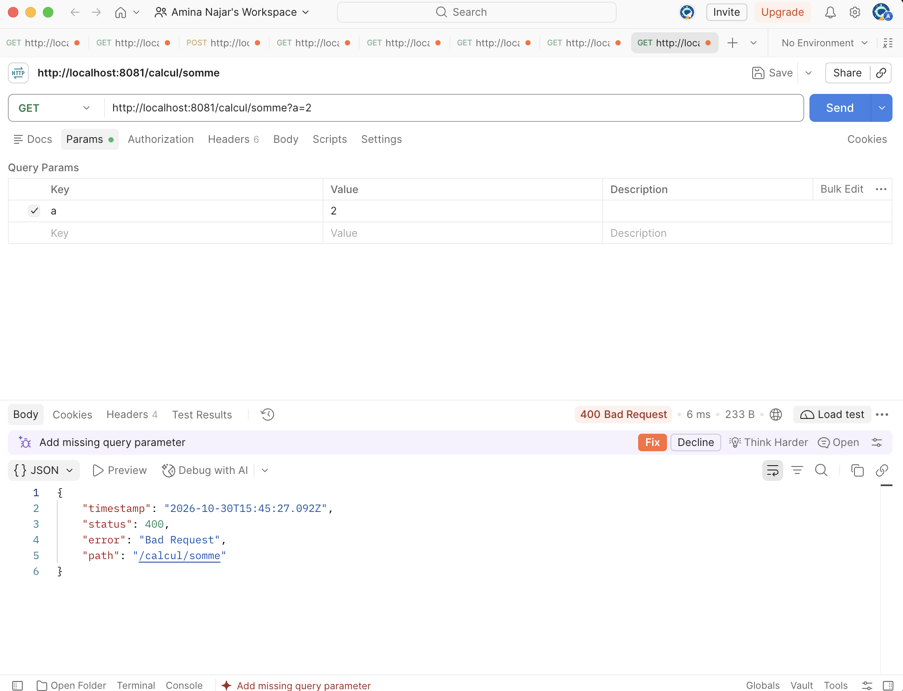
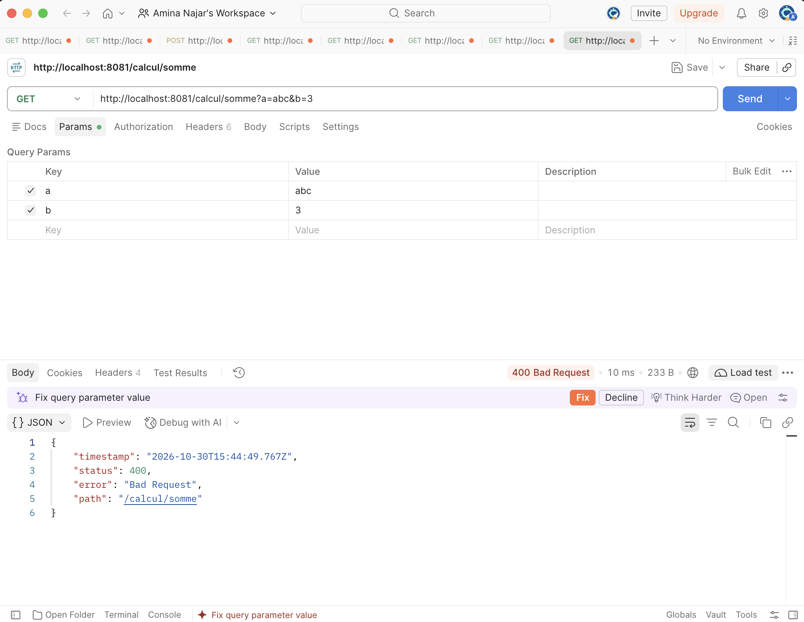

# TP3 REST : Microservices « Calculatrice » avec Spring Boot
|                         |                                                                                |
|-------------------------|--------------------------------------------------------------------------------|
| **Établissement**       | Faculté des Sciences de Sfax, Département d'informatique  |
| **Matière**             | Architecture MicroServices                                                     |
| **Filière**             | MPSRCC1                                                                        |
| **Étudiante**           | Amina Najar                                                                    |
| **Année universitaire** | 2026-2027

---
## Partie A : Questions de conception

#### A.1. Avantage et inconvénient d'un appel HTTP au lieu d'un appel de méthode

- #### Avantage :
    les deux services sont indépendants (couplage faible) : calcul-service peut être modifié, redéployé ou dupliqué sans toucher à historique-service, et il peut être réutilisé par d'autres clients.
- #### Inconvénient : 
     un appel réseau est plus lent et moins fiable qu'un appel de méthode locale (latence, service arrêté, erreurs réseau à gérer)
#### A.2.Si calcul-service est arrêté, quelles requêtes du tableau A.2 continuent de fonctionner ? Lesquelles échouent ?
 - ##### Les requêtes Échouent:
                - GET :8081/calcul/somme?a=2&b=3
                - GET :8081/calcul/soustraction?a=2&b=3
                - GET :8081/calcul/produit?a=2&b=3
                - GET :8081/calcul/division?a=6&b=3
                - POST :8082/operations
                - PUT :8082/operations/{id}
- ##### Les requêtes Continuent de fonctionner:
                - GET :8082/operations
                - GET :8082/operations/{id}
                - DELETE :8082/operations/{id}
##### A.3.Pourquoi les deux microservices ne peuvent-ils pas écouter sur le même port ?
Un même port ne peut généralement être utilisé que par un seul processus à la fois sur une même adresse IP. Chaque microservice doit donc avoir son propre port d’écoute.

##### A.4.Quel code de statut HTTP historique-service doit-il renvoyer quand il ne parvient pas à joindre calcul-service ? (Indication : ce n'est ni une erreur du client, ni un bug du serveur ; cherchez dans la famille des codes 5xx.)
Code de statut quand calcul-service est injoignable 503 Service Unavailable : le client a envoyé une requête correcte et le serveur n'a pas de bug, mais un service dont il dépend est indisponible.

## Partie C : Premier microservice

##### C.1 Comparez cette URL avec celle du TP2 (http://localhost:8080/RestWebApp/api/calcul/somme?a=2&b=3). Quelles parties ont disparu, et pourquoi ?
les parties qui sont disparu :
- /RestWebApp : c'était le nom du .war (contexte) sous lequel Tomcat déployait l'application. Ici l'application est lancée seule, directement à la racine /.
- /api : c'était le préfixe défini par @ApplicationPath("/api") dans RestApplication. Il n'y a plus de classe RestApplication avec Spring Boot, donc plus de préfixe.

##### C.2. Remplacez GET par POST dans Postman et renvoyez la requête. Quel code de statut obtenez-vous ? Est-ce le même qu'au TP2 ?
<p align="center">

   <br>
  <strong>Figure 1 : Resultat du remplacez GET par POST dans Postman </strong>
</p>
Un POST sur /calcul/somme renvoie 405 Method Not Allowed, car la méthode n'est mappée que sur GET

## Partie D : Compléter la calculatrice
##### D.3 Observations
<p align="center">
  
  <br>
  <strong>Figure É: GET /calcul/somme?a=2 (le paramètre b est absent)</strong>
</p>

<p align="center">
  
  <br>
  <strong>Figure 2 : GET /calcul/somme?a=abc&b=3 (le paramètre a n'est pas un entier)</strong>
</p>

##### D.1. Au TP2, JAX-RS donnait la valeur 0 à un paramètre entier absent et la méthode somme s'exécutait. Que fait Spring dans le même cas ? Laquelle des deux attitudes vous paraît la plus conforme à REST ?
le paramètre @RequestParam est obligatoire par défaut, et la méthode n'est pas exécutée. L'attitude de Spring est plus conforme à REST : un paramètre manquant ou invalide est une erreur du client et doit être signalée explicitement, au lieu de calculer silencieusement un résultat faux avec 0

##### D.2 Avec curl ou Postman, Spring renvoie ses messages d'erreur sous forme d'objet JSON. Quels champs contient-il ?
Comme le montrent clairement les captures de la partie **D.3 – Observations**, l'objet JSON d'erreur contient les champs suivants : `timestamp`, `status`, `error` et `path`.

##### D.3.Complétez le tableau de correspondance : à quelles annotations JAX-RS correspondent @RequestParam et @PathVariable ? Laquelle utilisera-t-on pour lire l'identifiant dans /operations/{id} ?

| Spring          | JAX-RS        |
|-----------------|---------------|
| `@RequestParam` | `@QueryParam` |
| `@PathVariable` | `@PathParam`  |

Pour lire l'identifiant dans `/operations/{id}`, on utilisera **`@PathVariable`**.
## Partie E : JSON
##### E.1. Au TP2, JSON-B avait produit {"a":2,"b":3,"operation":"somme","resultat":5.0}. Les deux textes JSON sont-ils équivalents pour un client ? Qui a effectué la conversion cette fois-ci ?
les deux JSON sont équivalents : un objet JSON est un ensemble de paires clé/valeur non ordonnées, l'ordre des champs n'a aucune importance pour le client. Cette fois, la conversion a été faite par Jackson inclus dans spring-boot-starter-webmvc, et non par JSON-B.
##### E.2. Pourquoi la seconde requête est-elle refusée, alors que le code de la méthode ne mentionne aucun format ?
Spring choisit le format de réponse selon les convertisseurs (HttpMessageConverter) disponibles pour le type Resultat. Seul Jackson est présent, et il ne sait produire que du JSON (pas de module XML). Comme le client demande application/xml, aucun convertisseur ne peut répondre : Spring renvoie 406 Not Acceptable, même si la méthode ne mentionne aucun format.

#### Partie F : Second microservice : historique-service
### F.6 Tests de création et de lecture

| N° | Requête | Corps envoyé | Statut | Réponse attendue |
|---|---|---|---|---|
| 1 | POST /operations | `{"operateur":"somme","a":8,"b":2}` | 201 Created | En-tête `Location: .../operations/1` ; `{"id":1,"operateur":"somme","a":8,"b":2,"resultat":10.0}` |
| 2 | POST /operations | `{"operateur":"division","a":7,"b":2}` | 201 Created | `{"id":2,"operateur":"division","a":7,"b":2,"resultat":3.5}` |
| 3 | GET /operations | Aucun | 200 OK | Tableau JSON contenant les opérations 1 et 2 |
| 4 | GET /operations/2 | Aucun | 200 OK | L'opération 2 (division, résultat 3.5) |
| 5 | GET /operations/99 | Aucun | 404 Not Found | Aucun corps |
| 6 | POST /operations | `{"operateur":"division","a":7,"b":0}` | 400 Bad Request | `{"erreur":"Calcul impossible (division par 0)"}` |
| 7 | POST /operations | `{"operateur":"racine","a":9,"b":0}` | 400 Bad Request | `{"erreur":"Opérateur inconnu : racine"}` |


### F.7 Arrêt de `calcul-service`

| N° | Requête | Corps envoyé | Statut | Réponse attendue |
|---|---|---|---|---|
| 8 | GET /operations | Aucun | 200 OK | La liste des opérations déjà enregistrées |
| 9 | GET /operations/1 | Aucun | 200 OK | L'opération 1 |
| 10 | POST /operations | `{"operateur":"produit","a":3,"b":4}` | 503 Service Unavailable | `{"erreur":"calcul-service est indisponible"}` |

##### Question F.1. Pourquoi les lectures continuent-elles de fonctionner alors que calcul-service est arrêté ? Une telle situation était-elle possible au TP2 ?
Les lectures n'utilisent que la liste en mémoire d'historique-service : elles n'ont pas besoin de calculer, donc pas besoin de calcul-service. Au TP2 c'était impossible : calcul et historique étaient dans le même .war ; si l'application était arrêtée, tout l'était (on ne pouvait pas arrêter une partie seulement).
##### Question F.2. Pendant l'arrêt de calcul-service, le client a reçu une réponse 503 en moins d'une seconde. Que se serait-il passé sans le bloc catch (ResourceAccessException e) ? Testez-le en le mettant en commentaire, puis remettez-le.
ans le bloc catch (ResourceAccessException e), l'exception remonte jusqu'à Spring, qui renvoie un 500 Internal Server Error (avec une trace d'erreur dans la console) : le client croirait à un bug du serveur au lieu d'une indisponibilité temporaire. La réponse est rapide car la connexion est refusée immédiatement (rien n'écoute sur le port 8081).
### F.8 PUT /operations/{id}

| Situation | Statut | Corps de la réponse |
|---|---|---|
| Aucune opération ne porte cet identifiant | 404 Not Found | Aucun |
| Calcul impossible (opérateur inconnu, division par 0) | 400 Bad Request | `{"erreur":"..."}` |
| `calcul-service` injoignable | 503 Service Unavailable | `{"erreur":"calcul-service est indisponible"}` |
| Modification réussie | 200 OK | L'opération modifiée en JSON (ex. `resultat` = 16.0) |
### F.9 DELETE /operations/{id}

| Situation | Statut | Corps de la réponse |
|---|---|---|
| Aucune opération ne porte cet identifiant | 404 Not Found | Aucun |
| Suppression réussie | 204 No Content | Aucun |

## Questions de synthèse
#### 1)
| Aspect | Étape |
|---|---|
| Technologie (Spring Boot / JAX-RS) | B.1, B.3 |
| Découpage (2 applications) | A.2, B.1, F.1 |
| Résultat de la construction (.jar) | B.3, C.5 |
| Serveur (Tomcat embarqué) | B.3, C.5 |
| Port | C.4 |
| Adresse | C.6 |
| Activation (`@SpringBootApplication`, `main`) | B.4 |
| Ressource REST (`@RestController`, `@RequestMapping`) | C.2 |
| Verbes HTTP | C.2, F.5, F.8, F.9 |
| Paramètres | C.2, D.4, F.5 |
| Réponse HTTP (`ResponseEntity`) | C.2, D.2 |
| Conversion JSON (Jackson) | E.2 |
| Création des objets (`@Service`, injection) | C.1, C.2 (remarque), F.4 |
| Communication (requête HTTP) | F.3, F.6 |
**2) Correspondance JAX-RS (TP2) ↔ Spring (TP3)**

| JAX-RS (TP2) | Spring (TP3) |
|---|---|
| `@ApplicationPath` + classe `RestApplication` | `@SpringBootApplication` + méthode `main` |
| `@Path("/calcul")` (classe) | `@RestController` + `@RequestMapping("/calcul")` |
| `@Path("/somme")` (méthode) | chemin dans `@GetMapping("/somme")` |
| `@GET` | `@GetMapping` |
| `@POST` | `@PostMapping` |
| `@PUT` | `@PutMapping` |
| `@DELETE` | `@DeleteMapping` |
| `@QueryParam` | `@RequestParam` |
| `@PathParam` | `@PathVariable` |
| paramètre objet + `@Consumes(JSON)` | `@RequestBody` |
| `@Produces(...)` | `produces = ...` |
| `Response.ok(...).build()` | `ResponseEntity.ok(...)` |
| `Response.status(...).entity(...).build()` | `ResponseEntity.status(...).body(...)` |
| `Response.created(uri).build()` | `ResponseEntity.created(uri)` |
| `uriInfo.getAbsolutePathBuilder()` | `ServletUriComponentsBuilder.fromCurrentRequest()` |
| JSON-B | Jackson |

### 3. Construire et lancer sans IntelliJ

Dans un premier terminal :
```bash
cd calcul-service
mvn clean package
java -jar target/calcul-service-0.0.1-SNAPSHOT.jar
```
Dans un second terminal :
```bash
cd historique-service
mvn clean package
java -jar target/historique-service-0.0.1-SNAPSHOT.jar
```
Il y a deux .jar exécutables à construire et à lancer séparément (contre un seul .war à déployer dans Tomcat au TP2). Aucun serveur à installer.
### 4. Microservice et service web

- Un microservice **est** un service web : `calcul-service` et `historique-service` exposent une API REST sur HTTP, accessible par n'importe quel client (`curl`, Postman ou un autre service).
- Un service web n'est **pas toujours** un microservice : `RestWebApp.war` du TP2 était un service web, mais monolithique : le calcul et l'historique étaient regroupés dans une même application, déployée dans un Tomcat partagé, qu'on ne pouvait pas démarrer ni redéployer indépendamment.

Un microservice est petit, autonome, possède son propre serveur et son propre port.
### 5. Adresse de `calcul-service` écrite dans `application.properties`
Avec trois exemplaires de `calcul-service` (ports différents), `historique-service` ne connaît qu'une seule adresse : tout le trafic va vers un seul exemplaire, les deux autres ne servent à rien, et la charge n'est pas répartie.
Si cet exemplaire tombe, `historique-service` n'utilise pas les autres, et il faut modifier la configuration et redémarrer pour changer d'adresse.
Il faudrait un mécanisme de découverte de services et de répartition de charge (TP4 : Spring Cloud).
### 6. Stateless et liste des opérations
Le principe stateless concerne l'**état de session du client** : le serveur ne garde pas de contexte de conversation entre deux requêtes, et chaque requête contient toute l'information nécessaire pour être traitée.
La liste des opérations est l'**état des ressources** (les données de l'application), partagé par tous les clients, et non un état propre à un client.
Les requêtes ne dépendent pas d'une requête précédente du même client : cela ne contredit donc pas le principe.

### 7. Vous envoyez deux fois la même requête POST /operations, puis deux fois la même requête PUT /operations/1. Comparez l'effet de la répétition dans les deux cas. La réponse est-elle différente de celle du TP2 ?
- POST /operations envoyé deux fois : deux opérations sont créées (ids différents, par exemple 1 et 2) : POST n'est pas idempotent.
- PUT /operations/1 envoyé deux fois : l'opération 1 est remplacée deux fois par le même contenu ; l'état final est identique à celui obtenu après un seul envoi : PUT est idempotent.
- La réponse n'est pas différente du TP2 : l'idempotence est une propriété de la sémantique HTTP des verbes, indépendante de la technologie (JAX-RS ou Spring).

